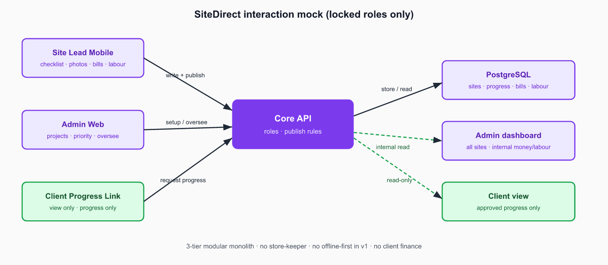
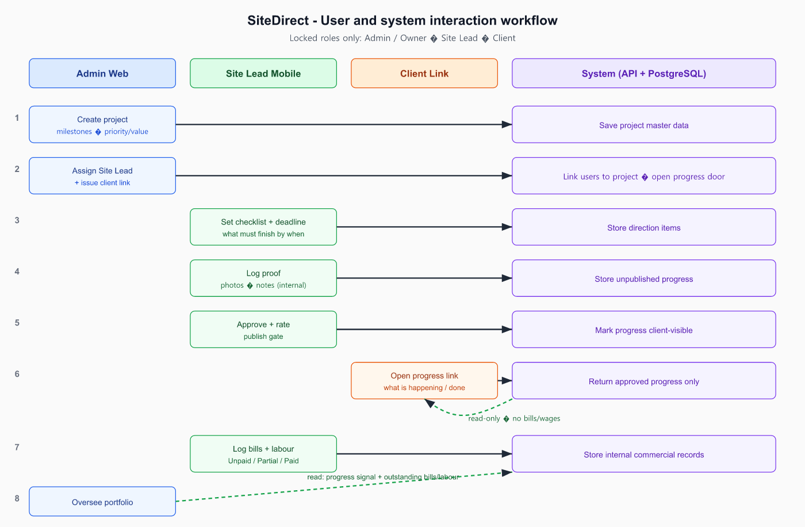

# Architecture — SiteDirect

**Status:** Stub — complete later  
**Plan reference:** [`plan.md`](./plan.md) §8

## Default stance (class guidance applied)
- **3-tier by default:** UI → API → database
- **Monolith until it hurts:** modular monolith for solo + one company
- **Microservices:** not for v1 (team/ops cost)
- **Functions/jobs:** only if a clear trigger appears later (e.g. scheduled digests) — not required for v1 core pain

## Chosen shape (locked direction)

| Layer | Choice | Why (one line) |
|-------|--------|----------------|
| Admin / Client UI | Web (React **or** Angular) | Office + progress link |
| Site Lead UI | Mobile app | Field entry is the daily habit |
| API | Single REST backend (e.g. Spring Boot) | One place for roles + publish rules |
| Data | PostgreSQL | Records, bills, labour, audit of publish |
| Style | Modular monolith | Solo student; avoid premature split |

## Diagrams (our roles only)

### Architecture / system shape


[`assets/interaction-flow.png`](./assets/interaction-flow.png) — who connects to Core API and PostgreSQL.

### User–system interaction workflow


[`assets/interaction-workflow.png`](./assets/interaction-workflow.png) — step-by-step workflow between Admin, Site Lead, Client, and the system (setup → direction → proof → publish → client view → bills/labour → oversee).

```text
[Site Lead Mobile] --checklist / proof / publish--> [Core API]
[Site Lead Mobile] --bills Unpaid|Partial|Paid + labour--> [Core API]
[Admin Web] --setup / assign / oversee--> [Core API]
[Client Progress Link] --read approved progress--> [Core API]
[Core API] <--> [(PostgreSQL)]
[Core API] --approved only--> [Client]
[Core API] --internal bills/labour--> [Admin]
```

## Explicitly not in v1 architecture
- Offline store + sync-later (logged for later)
- Store-keeper module
- Friday PDF report job (client money reports stay external)
- Microservices / event bus

## Open
- Exact mobile stack
- Hosting / CI-CD detail (DevOps course — fill later)
