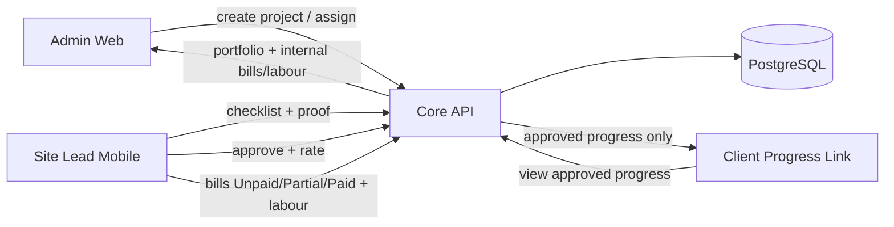

# Project Proposal

# Construction Company  
# SiteDirect — Site Progress & Site Operations System

A Web-Based Site Direction, Progress Proof, Client Progress Visibility, and Light Site Commercial Records System

| | |
|---|---|
| **Course** | Advanced DevOps |
| **Project type** | Solo Project (1 member) |
| **Team member** | Mohamed Arkkam (ONL-2026-0040) |

**Context:** A single construction company running one or many project sites; not a design office, QS platform, marketplace, or full ERP.  
**Product name:** SiteDirect (working name — final name to be decided later).

---

## Table of Contents

1. Introduction  
2. Problem Statement  
3. Scope  
4. Proposed Solution and Objectives  
5. Target Users  
6. Feature Priority  
7. Screens for Each User  
8. Main Quality of the System  
9. System Modules  
10. Interaction Mock  
11. Architecture  
12. Database  
13. Technology Stack  
14. Security  
15. Deployment, Backups and Monitoring  
16. Risks and How We Handle Them  
17. Expected Output  
18. Benefits  
19. Unique Feature  
20. Conclusion  

---

## 1. Introduction

A construction company wins a project (for example, a two-floor building), plans engineering and quantities outside this system, then executes work on site. The owner needs control across sites. The Site Lead needs a clear daily direction, proof of work, and light records for purchases and labour. The client often cannot stay on site and needs a simple, trustworthy view of progress.

The proposed system is designed specifically for a **single construction company**. It supports site direction through short checklists, progress proof with photos and notes, a publish step before the client can see updates, and internal tracking of site purchases (including unpaid/credit buys) and worker attendance/wages. Design drawings, QS, and detailed monthly client money reports remain outside the system.

---

## 2. Problem Statement

- Progress updates are scattered across calls, WhatsApp, and memory.
- Owners chase “what is happening?” instead of managing by exception across multiple sites.
- Clients receive unstructured photos and messages, which are easy to misunderstand.
- Site instructions are often verbal, with weak deadlines and weak proof of completion.
- Site purchases, including materials taken on credit without payment, are hard to track per site.
- Attendance and wages (daily or monthly, depending on the worker) are hard to keep consistent per site.
- Detailed money-versus-work reports may already be prepared monthly in Excel or other documents; the live gap is trusted day-to-day progress.

**Core pain (in the client’s / owner’s words):**  
“We’re working on site, but I can’t trust one simple view of progress — and I’m tired of chasing updates on WhatsApp.”

**Main problem (system framing):** The owner, Site Lead, and client do not share one trusted chain of directed work, proof, and simple client progress — while company spend stays internal.

---

## 3. Scope

**Scope sentence:** SiteDirect is for a single construction company (owner/admin, site lead, and client progress visibility). It is not for design/QS offices, multi-company marketplaces, or full ERP/accounting.

### The System Is Designed For

- A single construction company (one vendor).
- One or many project sites under that company.
- Feeding required project data from external plans (phases/milestones), without creating drawings or BOQ inside the system.
- Three authorized user roles:
  - **Administrator / Owner:** Sets up projects, assigns people, keeps priority/value internally, and oversees progress, bills, and labour.
  - **Site Lead:** Directs site work, records proof, publishes client progress, and logs site purchases and labour.
  - **Client:** Views a simple progress link for their own project only.
- Site Lead short checklists with deadlines (direction, not full project management).
- Progress logging with photos/notes and Site Lead approve + rate before client visibility.
- Site purchase bills with **Paid / Unpaid / Partial** status (credit buys / material taken without immediate payment).
- Worker attendance and wages: daily wage or monthly salary, as defined by the owner for each worker.
- Multi-site operation (one Site Lead may cover more than one site).
- Mobile application for Site Lead field use (Version 1 requirement).

### The System Is Not Designed For

- Design, drawing editing, blueprint authoring, or QS/BOQ tools.
- Public marketplace, standby labour marketplace, or multi-company SaaS marketplace.
- Full ERP/accounting, GST suites, Tally-class finance, or complex payroll/PF.
- Client view of company spend, bills, wages, or attendance.
- Replacing the company’s existing weekly/monthly detailed financial client reports (Excel or other documents).
- Heavy project management (Gantt charts, deep task trees, dependency engines).
- Subcontractor login accounts.
- Full warehouse/inventory ERP and automatic purchasing.
- Real-time GPS fleet tracking or IoT site sensors.

---

## 4. Proposed Solution and Objectives

- **Setup:** Administrator creates a project, feeds milestones from external plans, sets internal priority/value, assigns a Site Lead, and issues a client progress link.
- **Direct:** Site Lead sets a short checklist of what must be completed by when.
- **Execute and prove:** Site Lead pushes work on site and logs progress with photos/notes.
- **Publish:** Site Lead approves and rates an update before the client can see it.
- **Client view:** Client opens a progress-only link for their project.
- **Site purchases:** Site Lead logs buys with amount and Paid/Unpaid/Partial status (including credit/unpaid material).
- **Labour:** Site Lead records attendance and wages/salary by worker pay type.
- **Oversee:** Administrator reviews multi-site progress signals and internal bills/labour, focusing on high-priority sites.

### Objectives

- Centralize project, milestone, progress, purchase, and labour records for one construction company.
- Make site direction explicit through short checklists and deadlines.
- Keep client visibility trusted through approve + rate before publish.
- Keep company spend and labour internal to Admin/Site Lead only.
- Track unpaid/credit site purchases clearly as liability until paid.
- Support daily-wage and monthly-salary workers.
- Support multiple sites under one company.
- Protect data with role-based access.
- Keep Version 1 achievable and avoid becoming a full construction OS.

### Painkiller check (why Version 1 is worth using)

Version 1 is worth adopting because it kills the daily pain of chasing site updates: the owner gets a multi-site signal with less calling around; the client gets a trusted progress window; the Site Lead gets one light place to direct, prove, publish, and log site buys/labour — without forcing the company to move its monthly money report out of Excel.

---

## 5. Target Users

| User | Need | Interaction | Availability | Knowledge |
|------|------|-------------|--------------|-----------|
| Administrator / Owner | Control many sites; priority/value; see bills and labour; less chasing | Web | Office hours | Business-focused; not day-to-day field detail |
| Site Lead | Direct work, prove it, publish, log buys and attendance | Mobile app (required in V1) | On site, time-pressured | Strong site practice; little patience for heavy forms |
| Client | Know what is happening / what has been done | Progress link only | Occasional checks | Non-technical; must not see company finance |

Clients use a **progress link** (responsive web). They do not see company bills, wages, or internal priority/value. Detailed monthly money reports continue outside this system. Site Lead work is delivered through a **mobile app** in Version 1.

---

## 6. Feature Priority

Features are grouped as **Core** (must ship), **90** (high everyday value), **10** (optional / decide later), and **Logged** (out of Version 1 but recorded for later).

| Feature | Priority | Decision |
|---------|----------|----------|
| Login and roles (Admin, Site Lead, Client) | Core | Version 1 |
| Project setup; phases/milestones fed by Admin | Core | Version 1 |
| Admin-only priority / value / importance note | Core | Version 1 |
| Site Lead checklist with deadlines | Core | Version 1 |
| Progress proof (photos/notes) | Core | Version 1 |
| Approve + rate before client visibility | Core | Version 1 |
| Client progress link (progress only) | Core | Version 1 |
| Site purchases with Paid / Unpaid / Partial | Core | Version 1 |
| Attendance; daily wage or monthly salary | Core | Version 1 |
| Multi-site assignment | Core | Version 1 |
| Mobile app for Site Lead | Core | Version 1 |
| Clear unpaid/partial liability view for Admin | 90 | Version 1 (high value) |
| Short daily checklists + quick photo proof | 90 | Version 1 (high value) |
| Admin approval gate before bills/wages are final | 10 | Decide later |
| Material source: store / outside buy / client-supplied | Logged | Outside MVP |
| Client money-vs-work statement in-app | Logged | Kept in Excel/other reports |
| Offline-first mobile sync | Logged | Later if pilot needs it |
| Design/QS, marketplace, full ERP, Gantt PM | Logged / Excluded | Not planned |

**Priority reason:** Trusted site direction and client progress visibility are the main focus, with a thin internal notebook for site bills and labour. This makes the system different from WhatsApp, a generic task app, or a full construction ERP.

---

## 7. Screens for Each User

### Interface matrix (which user gets which door)

| User | Door (interface) | Main screens | Key actions |
|------|------------------|--------------|-------------|
| Administrator / Owner | Web | Portfolio dashboard, projects, users/assignments, bills, labour, progress overview | Create projects, set priority/value, assign Site Lead/Client, review unpaid bills and exceptions |
| Site Lead | Mobile app | My sites, checklist, progress/proof, publish, purchases, attendance/wages | Direct work, log proof, approve+rate, log paid/unpaid/partial buys, mark attendance |
| Client | Progress link (web) | Progress page | View approved progress, photos, dates |

Administrators access the system through a web browser. **Site Leads use a mobile application in Version 1** for field work. Clients use a responsive progress link in the browser. A separate native client app is not required.

**Interface for clients:** Clients have a progress-only interface for their project. There is no client finance portal and no access to other projects or company internal spend.

---

## 8. Main Quality of the System

### Primary Quality: Trusted Progress Chain

The system must keep a clear chain from directed work to proof to client-visible progress. Clients must never see unpublished updates. Progress shown to the client must be approved and rated by the Site Lead.

### What we traded away for that quality

To protect the trusted progress chain and keep Version 1 achievable, the product deliberately trades away: client finance inside the app, a second approver role, full project-management / ERP features, offline-first sync, and design/QS tools.

### Secondary Quality: Clear Internal Site Records

The system should make unpaid purchases obvious to Admin, keep labour records simple, and remain easy enough for a Site Lead to update in a few minutes on a phone.

### Limitations (Version 1)

- Mobile app is required for Site Lead; offline-first sync is not promised unless later enhanced, so field use still needs network access for live updates.
- No automatic replacement of the company’s monthly detailed client money reports.
- No full accounting, warehouse ERP, or design tools.
- The same Site Lead both records and publishes progress (acceptable for small teams; Admin may spot-check).
- Whether Admin must approve bills/wages before they are final is deferred (decide later).

---

## 9. System Modules

### 9.1 Authentication and Roles

Administrator manages users and project assignments. Site Lead works on assigned sites. Client accesses only the assigned project progress view. Passwords are hashed and permissions are checked by the API.

### 9.2 Projects and Milestones

Projects store name, location/client reference, dates, and Admin-only priority/value. Milestones/phases are fed from external plans. Referenced records are deactivated, not hard-deleted, where practical.

### 9.3 Direction (Checklist)

Site Lead creates short checklist items with deadlines for a project. This is daily/near-term direction, not a full project-management suite. Keeping lists short is a product rule.

### 9.4 Progress and Proof

Site Lead logs progress against checklist items or milestones using notes and photos. Entries remain internal until published.

### 9.5 Trust Gate (Publish)

Site Lead approves and rates an update. Only then does it become visible on the client progress link. Rejected or draft items stay internal.

### 9.6 Client Progress View

Client sees high-level approved progress: what is happening / what has been done, photos, and dates. No bills, wages, attendance, or Admin priority/value. (Rating deferred.)

### 9.7 Site Purchases

Site Lead records purchases for site work: description/note, amount, optional bill photo, and payment status (**Unpaid**, **Partial**, or **Paid**). Unpaid/Partial covers material taken on credit without full payment. Admin can see outstanding liability per site.

### 9.8 Labour (Attendance and Wages)

Workers are assigned to projects with a pay type: daily wage or monthly salary. Site Lead records attendance and wage/salary entries. This data is internal only.

### 9.9 Admin Portfolio Overview

Administrator views projects with priority/value, recent publish activity, and internal bills/labour signals to focus on important or stuck sites.

### 9.10 Material Sourcing Extensions (Future Enhancement)

A future version may tag material as company-store issue, outside purchase, or client-supplied. Full warehouse ERP remains out of scope.

---

## 10. Interaction Mock

### Interaction flow diagram

**Flow in words:** Admin sets up the project and people. Site Lead directs work, records proof, publishes with approve + rate, and logs bills/labour. Client sees only approved progress. Admin sees portfolio plus internal commercial records. Everything is stored through the Core API in PostgreSQL.

| # | From | What is sent | To | What happens |
|---|------|--------------|----|--------------|
| 1 | Administrator | Staff/client account and role details | Core API | User account is created or updated |
| 2 | Administrator | Project details, milestones, priority/value | Core API | Project master data is saved |
| 3 | Administrator | Site Lead and Client assignment | Core API | Users are linked to the project; client progress link becomes available |
| 4 | Site Lead (mobile) | Checklist item and deadline | Core API | Direction item is saved for the project |
| 5 | Site Lead (mobile) | Progress notes and photos | Core API | Internal progress proof is stored |
| 6 | Site Lead (mobile) | Approve + rate (publish) | Core API | Update becomes visible on client progress view |
| 7 | Client | Open progress link | Core API | Approved progress only is displayed |
| 8 | Site Lead (mobile) | Purchase details and Unpaid/Partial/Paid status | Core API | Site bill is recorded; outstanding amounts remain visible to Admin |
| 9 | Site Lead (mobile) | Update purchase payment status | Core API | Liability status is updated |
| 10 | Site Lead (mobile) | Attendance and wage/salary entry | Core API | Labour record is saved for the project |
| 11 | Administrator | Portfolio / unpaid bills / labour view | Core API | Cross-site internal summary is displayed |
| 12 | Core API | Projects, progress, bills, labour | PostgreSQL | Permanent records are stored for future reference |

Each interaction maps to a screen, a REST API operation, and a database rule. Client reads never expose internal purchase or wage tables.

---

## 11. Architecture

**Choice:** a modular monolith. Admin and Client use web frontends; Site Lead uses a mobile app; a single backend REST API handles business rules; one PostgreSQL database stores transactional records. Only the backend accesses the database.

| Decision | Choice | Reason |
|----------|--------|--------|
| Structure | Single modular backend | Suitable for one company and a solo developer |
| Client visibility | Publish gate (approve + rate) | Prevents raw site noise reaching the client |
| Money boundary | Client progress only; bills/labour internal | Matches existing external finance reporting |
| Purchase payment | Unpaid / Partial / Paid on each bill | Tracks credit buys without full accounting |
| Field access | Mobile app for Site Lead; web for Admin; progress link for Client | Matches real site use |
| Deployment | Simple hosted app + database | Avoids unnecessary infrastructure in V1 |
| Not chosen | Microservices / marketplace / full offline-first | Unnecessary complexity for MVP |

Offline-first sync is not promised in Version 1; the Site Lead mobile app is expected to work with normal mobile network access.

---

## 12. Database

PostgreSQL is the database used to store and manage project, progress, purchase, and labour information. It supports role-based views of data and keeps client progress separate from internal commercial records.

**Main tables:** Users, Projects, ProjectAssignments, Phases/Milestones, ChecklistItems, ProgressEntries, ApprovalPublishes, SitePurchases (payment status: Unpaid/Partial/Paid), Workers, WorkerProjectAssignments, AttendanceRecords, WageEntries, (optional) ReferenceDocuments.

**Main chains:**
- Admin → Project → Milestones → Site Lead assignment → Client link
- Checklist item → Progress entry → Approve/Rate → Client progress view
- Site purchase → Unpaid/Partial/Paid status → Admin liability view
- Worker → Attendance / Wage entry → Admin labour view

**Main rules:** Client can read only published progress for assigned projects; unpublished progress is internal; purchase and wage records are never exposed to clients; stock-style negative rules are not the focus — unpaid bills must remain visible until marked Paid; completed publish actions should retain who published and when.

---

## 13. Technology Stack

| Layer | Proposed technology |
|-------|---------------------|
| Frontend (Admin / Client web) | React **or** Angular, with TypeScript, HTML, CSS (final choice by delivery preference) |
| Mobile (Site Lead) | To be finalized (native or cross-platform app calling the same REST API) |
| Backend | Java 21, Spring Boot, Spring Security, Spring Data JPA |
| Database | PostgreSQL, Flyway |
| API | REST, OpenAPI / Swagger |
| Testing | JUnit, Mockito, integration tests |
| Source control | Git and GitHub |
| CI/CD | To be finalized (e.g. GitHub Actions) |
| Containers | Optional Docker for local/repeatable setup |
| Hosting | To be finalized |
| Monitoring | Application logs, health endpoint, basic uptime checks |

**Note:** Frontend may be implemented in **React or Angular**. Either choice is acceptable; the business scope stays the same. Final framework can be selected based on familiarity and delivery preference.

---

## 14. Security

- Password hashing and secure login; enforce role permissions on backend routes.
- Clients can access only their assigned project progress data.
- Validate all user input; use a safe ORM / parameterized queries.
- Keep database passwords and secrets in environment variables, never in Git.
- Keep a record of publish actions (who approved/rated and when).
- Use a private database connection, basic backups, and least-privilege accounts.

---

## 15. Deployment, Backups and Monitoring

- **Code:** Git with branches and reviews.
- **CI/CD:** Automated tests where practical; pipeline details to be finalized.
- **Hosting:** Application and PostgreSQL hosting to be selected later.
- **Monitoring:** Health checks for availability.
- **Logs:** Application logs for errors and key actions (publish, bill status changes).
- **Backups:** Regular PostgreSQL backups and backup of uploaded photos/bill images.
- **Testing:** Automated tests for role access, publish visibility rules, and unpaid bill status behaviour.

---

## 16. Risks and How We Handle Them

| Risk | Impact | Mitigation |
|------|--------|------------|
| Site Lead does not update daily | Empty client progress; owner loses trust | Keep logging short; Admin watches high-priority quiet sites |
| Same person records and publishes | Weaker second check | Accept for small V1 teams; Admin spot-checks; keep client view simple |
| Scope grows into full PM/ERP | Unfinished or unusable system | Strict exclusions; short checklists only |
| Unpaid/partial purchases forgotten | Hidden site liability | Mandatory Unpaid/Partial/Paid status; Admin outstanding view |
| Client expects finance in the app | Confusion and scope creep | Progress-only client rule; money reports stay external |
| Too many features for the team | Unfinished application | Focus on core chain first; defer optional items |
| No access to real site operations | Unverified assumptions | Validate workflow with a Site Lead / company contact |

---

## 17. Expected Output

- Admin can create a project, feed milestones, set priority/value, and assign Site Lead and Client.
- Site Lead can create checklist items, log proof, and publish with approve + rate.
- Client progress link shows only approved updates.
- Site Lead mobile app can log purchases as Unpaid, Partial, or Paid; Admin can see outstanding amounts.
- Site Lead can record attendance and daily/monthly wage entries.
- Multiple sites can run under one company with separated client views.
- Role rules prevent clients from seeing bills and wages.

**Success check:** A client cannot see an unpublished progress entry; an Unpaid or Partial purchase remains visible to Admin until marked Paid; a Site Lead can complete a normal site update from the mobile app (checklist item + proof + publish + optional bill/attendance) in a short session; each client sees only their own project progress.

---

## 18. Benefits

| Group | Benefit |
|-------|---------|
| Administrator / Owner | Less chasing, clearer multi-site focus, internal view of bills and labour |
| Site Lead | One light place for direction, proof, publish, purchases, and attendance |
| Client | Calm, trusted progress window without finance noise |
| Company | More professional site communication without replacing existing monthly money reports |
| Development team | Practical full-stack experience with clear role boundaries and publish rules |

---

## 19. Unique Feature

**Site Lead publish gate with internal site commercial notebook:** the system does not treat every photo or message as client-ready. The Site Lead directs short work items, records proof, and only after approve + rate does the client see progress. At the same time, site purchases (including unpaid/credit material) and labour stay inside the company for Admin — while detailed client money reports remain in the company’s existing Excel/document process.

**Example:** On Project A (high priority), the Site Lead uses the mobile app to set “finish south steel binding by 5 PM,” logs photos, approves and rates the update as On track, and records binding wire ₹2,400 as **Unpaid** (later may become Partial or Paid). The client sees only the approved progress. The owner sees the progress signal and the outstanding liability, and still prepares the monthly money report outside the system as usual.

---

## 20. Conclusion

This proposal focuses on a single construction company rather than a generic field-service or warehouse product. Its core problem is a trusted chain of directed site work, proof, and simple client progress — plus light internal tracking of site purchases and labour. A modular backend with an Admin/Client web interface (React or Angular) and a Site Lead mobile app provides a practical foundation for a solo Advanced DevOps project. The scope is deliberately limited so one student can implement and evaluate the essential business rules without building a full construction ERP, design suite, or marketplace.

---

*End of proposal*
