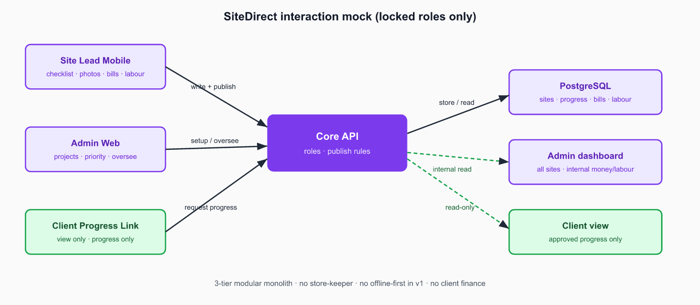
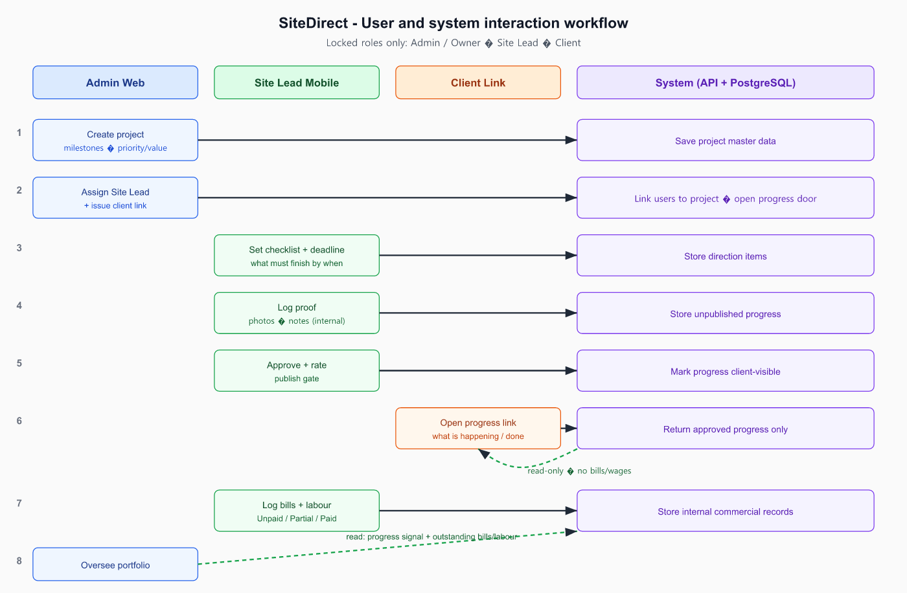
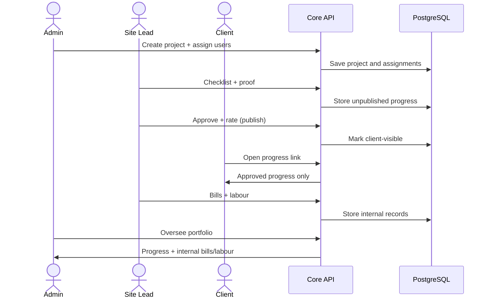

# SiteDirect — Project Plan (`docs/plan.md`)

**Course:** Advanced DevOps  
**Student:** Mohamed Arkkam (ONL-2026-0040)  
**Product (working name):** SiteDirect  
**Status:** Plan for this week (no code yet)

---

## 1. Scope

SiteDirect is for a **single construction company**: the owner/admin running projects, the site lead running the site day, and the client who only needs trusted progress visibility.

It is **not** for design/QS offices, multi-company marketplaces, full ERP/accounting, or a second field role split (supervisor vs recorder are combined as **Site Lead**).

---

## 2. Users

Only locked roles: **Admin / Owner**, **Site Lead**, **Client**.

| User | Need | Interaction | Availability | Knowledge |
|------|------|-------------|--------------|-----------|
| Admin / Owner | Control many sites; set priority/value; see internal bills and labour; chase less | Web | Office hours | Business-focused; not day-to-day field detail |
| Site Lead | Direct work, prove it, publish to client, log buys and attendance/wages | Mobile app (required in v1) | On site, time-pressured | Strong site practice; little patience for heavy forms |
| Client | Know what is happening / what has been done | Progress link only (view) | Occasional checks | Non-technical; must not see company finance |

---

## 3. Core pain

> “We’re working on site, but I can’t trust one simple view of progress — and I’m tired of chasing updates on WhatsApp.”

---

## 4. Features

### Core
- Login and roles (Admin, Site Lead, Client)
- Project setup; milestones fed by Admin from external plans
- Admin-only priority / value
- Site Lead short checklist with deadlines
- Progress proof (photos/notes)
- Approve + rate before client visibility
- Client progress link (progress only)
- Site purchases: Unpaid / Partial / Paid
- Attendance; daily wage or monthly salary per worker
- Multi-site under one company
- Site Lead responsive web (`sitelead-web`); Expo native later

### 90/100
- Clear outstanding (unpaid/partial) liability view for Admin
- Very short daily checklist + quick photo proof (fast field entry)

### 10/100
- Admin must approve bills/wages before they count as final *(decide later)*

### Logged-only (not v1)
- Material source tags (company store / outside buy / client-supplied)
- Client money-vs-work statement in-app (stays in Excel/other docs for now)
- Offline-first mobile sync
- Design/QS tools, marketplace, full ERP, Gantt PM

---

## 5. Painkiller test

v1 is worth paying for / adopting because it stops daily chasing: owner sees multi-site signal, client sees only trusted progress, Site Lead directs–proves–publishes and logs site buys/labour in one light tool — without replacing the company’s monthly Excel money report.

---

## 6. Interfaces

| User | Web | Mobile | Device | Notification | API |
|------|:---:|:------:|:------:|:------------:|:---:|
| Admin / Owner | Yes (main door) | No (not required) | Desktop / laptop | Later (optional) | Via backend |
| Site Lead | **Yes (main door, responsive web)** | Native Expo later | Phone browser on site | Later (optional) | Via backend |
| Client | **Progress link only** | Browser on phone OK | Phone / laptop | No push in v1 | Read-only via backend |

**v1 doors:** Admin = web · Site Lead = **mobile-responsive web** (`apps/sitelead-web`) · Client = progress link. Native Expo (`apps/sitelead-mobile`) is deferred.

---

## 7. Main quality

**Primary quality:** Trusted progress chain (direct → prove → approve+rate → client sees).

**Traded away for it:**
- Client finance inside the product
- Separate supervisor + recorder roles
- Full PM / ERP / design-QS scope
- Offline-first sync in v1
- Heavy reporting automation (Friday PDF jobs, etc.)

---

## 8. Interaction mock + architecture

### Architecture choices (with one-line why)

| Choice | Decision | Why |
|--------|----------|-----|
| Architecture tier | **3-tier** (UI → API → DB) | Clear default for a small solo project |
| Style | **Modular monolith** until it hurts | One student, one company; microservices add team/ops cost too early |
| Database | **PostgreSQL** | Money-ish records, attendance, publish audit, relational integrity |
| Not chosen now | Microservices / Mongo-first / offline-first | No team split, no bursty document workload, network assumed for v1 sync |

### Interaction mock (boxes + labelled arrows)

```text
[Site Lead Web] --checklist / proof / publish--> [Core API]
[Site Lead Web] --bills Unpaid|Partial|Paid + labour--> [Core API]
[Admin Web] --create project / assign / oversee--> [Core API]
[Client Progress Link] --request progress--> [Core API]
[Core API] --store / read--> [(PostgreSQL)]
[Core API] --approved progress only--> [Client Progress Link]
[Core API] --portfolio + internal bills/labour--> [Admin Web]
```

**Rules on the arrows**
- Client path is **read-only** and **approved-only** (no bills, no wages).
- Publish = Site Lead approve + rate.
- Admin sees internal commercial data; client never does.
- Every arrow is a product decision (who may write, who may read, what is filtered).

### Architecture diagram (system shape)



*Boxes and labelled arrows: who talks to the Core API and database (Admin Web, Site Lead Web, Client Progress Link).*

### Interaction workflow diagram (users ↔ system)



Step flow between users and the system:

1. **Admin** creates project (milestones, priority/value) → system stores master data  
2. **Admin** assigns Site Lead and issues client link → system opens access doors  
3. **Site Lead** sets checklist + deadline → system stores direction  
4. **Site Lead** logs proof (photos/notes) → system keeps it internal  
5. **Site Lead** approve + rate → system marks progress client-visible  
6. **Client** opens progress link → system returns **approved progress only** (no bills/wages)  
7. **Site Lead** logs bills (Unpaid/Partial/Paid) + labour → system stores internal commercial records  
8. **Admin** oversees portfolio → system returns progress signal + outstanding bills/labour  



---

## Defense notes (15 minutes)

- **Who we help:** one construction company.  
- **What hurts:** no trusted progress chain; WhatsApp chasing.  
- **What we refuse:** finance portal for client, ERP, marketplace.  
- **Why Postgres + monolith:** records/money-like data + solo delivery.  
- **Why phone-first for Site Lead only:** that is where the daily pain is entered (responsive web now; native later).

---

*End of plan — expand into other docs later (`PRD`, `ARCHITECTURE`, etc.).*
